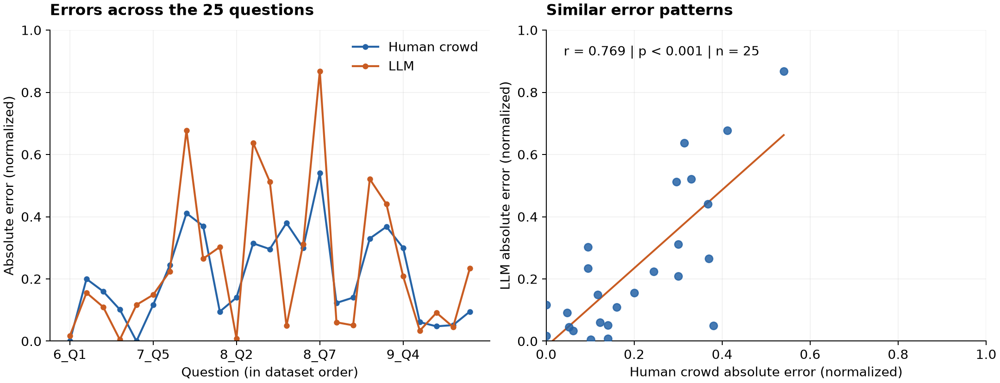

# Do large language models share human collective blind spots?

This repository was created for the GSERM course [Applying open-source LLMs in Social & Behaviour Sciences](https://gserm.org/courses-directory/applying-open-source-llms-in-social-behaviour-sciences/).
The project explores whether an LLM succeeds and fails on the same prediction tasks as a human crowd, and what this means for using LLMs as simulated participants in social-science research.

## Overview

The study uses 25 prediction tasks from the Norwegian television program **Alle mot 1** ("All against 1"). Viewers predict the numerical outcomes of real-world experiments, and the actual outcomes are then revealed. Each task therefore provides a human crowd prediction and an observed outcome against which predictions can be evaluated.

## Analysis

- **Model:** Qwen3-VL-30B-A3B-Thinking, accessed through Fireworks AI, with temperature set to 0.1.
- **Inputs:** Norwegian transcripts and selected screenshots of the experiments.
- **Design:** 25 questions × 4 baseline prompt templates × 3 repetitions = **300 model responses**. Two templates use an instructional format and two use a structured format.
- **Comparison:** Predictions are averaged across repetitions and normalized using each question's response range. The analysis compares error patterns, average error magnitude, and the direction of errors, first within each template and then across templates.

## Results

The model and crowd tended to make larger errors on the same questions (**r = 0.769**) and showed similar patterns of over- and underestimation (**r = 0.857**). The model's mean absolute error was slightly higher than the crowd's (**0.244 vs. 0.207** on the normalized scale).

*Left: crowd and model errors for each question. Right: each point represents one question. Model predictions are averaged across repetitions and prompt templates; errors are normalized using each question's response range. Figure generated from the notebook's saved results.*

## Repository structure

| File / folder | Description |
| --- | --- |
| [test_pipeline.ipynb](test_pipeline.ipynb) | Unpacks the workflow for **one question**. Shows how the prompts are built sent to the model, response schema, returned prediction, and comparison with the crowd and outcome. Start here to see the underlying prompt logic. |
| [Full_Pipeline.ipynb](Full_Pipeline.ipynb) | The **main analysis**, using all 300 responses from the 25-question pilot. Includes response variability, comparisons by prompt template, results across templates, tables, and figures. |
| [siliconcrowds/](siliconcrowds/) | The **custom Python package developed for this project**. Its modules contain classes for model calls, prompts and personas, response validation, database access, and matching questions with images. |
| [pyproject.toml](pyproject.toml) | Python version and core dependencies. |

## Personas

**Personas were created for the broader research project but were not used in this course analysis.** They were designed to resemble the Norwegian TV audience using demographic statistics, iterative proportional fitting (IPF), and weights to approximate the audience's demographic composition.

The package supports loading persona records, turning them into prompts, and retrieving persona-based prompt templates.

## Usage

The notebooks include saved outputs and can be read directly on GitHub. 
The analysis reads saved experiment from Supabase. Its optional experiment-generation block is disabled and references database-writing methods absent from this version of the package. 

**The repository therefore supports inspecting the course work, but a fresh clone alone cannot reproduce the experiment.**

Code and analysis by [Roya Esfandiari](https://github.com/roya-esfan).
